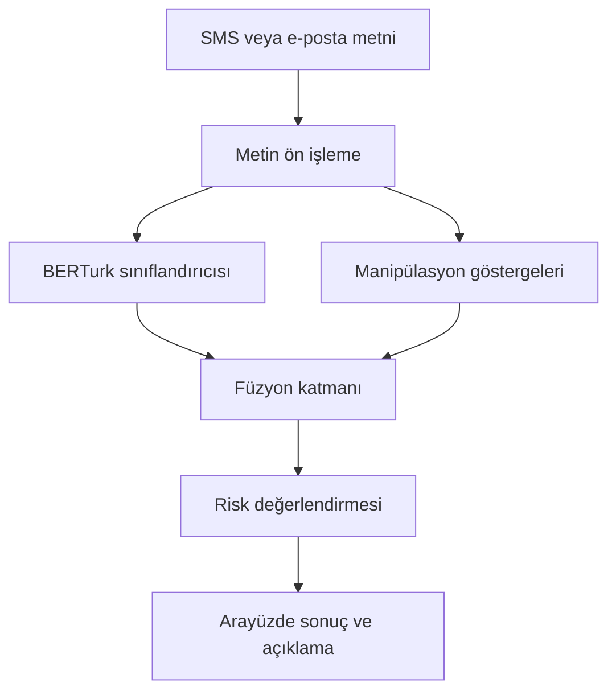

# MM-HEAF — Dinamik Kapılı Füzyon Oltalama Tespit Sistemi

> Türkçe SMS ve e-posta metinlerindeki dolandırıcılık riskini BERTurk ve manipülasyon göstergelerini birlikte değerlendirerek incelemeyi amaçlayan araştırma projesi.

Bu çalışmada, mesajların dilsel içeriğinin yanında aciliyet, otorite taklidi ve hassas bilgi talebi gibi sosyal mühendislik göstergelerinin de değerlendirilmesi hedeflenmektedir. Mevcut prototipin veri kalitesi, füzyon mimarisi ve deneysel değerlendirmesi üzerinde geliştirmeler sürmektedir.

**Durum:** Araştırma ve prototip geliştirme aşamasında.  
**Son durum kaydı:** 18.10.2026.

**Demo görseli:** Uygulamanın analiz ekranına ait görsel henüz bu depoya eklenmemiştir. Arayüz ekran görüntüsü veya kısa demo GIF'i hazırlandığında bu bölüme eklenecektir.

## Özet

| Başlık | Açıklama |
| --- | --- |
| Problem | Türkçe mesajlarda dolandırıcılık ve sosyal mühendislik riskinin tespit edilmesi. |
| Yöntem | BERTurk tabanlı metin sınıflandırması ile kural tabanlı manipülasyon göstergelerinin birlikte değerlendirilmesi; dinamik kapılı füzyonun geliştirilmesi ve karşılaştırmalı incelenmesi. |
| Yazılım / çalışma ortamı | Python, Transformers, BERTurk, FastAPI ve HTML tabanlı arayüz. Yerel prototip mevcut; çevrim içi sunum çalışmaları sürüyor. |
| Model ve deney dosyaları | [Hugging Face model deposu](https://huggingface.co/nilittle/saved_bertturk_phishing_model). |
| Kaynak kod | [GitHub deposu](https://github.com/Nihle07/heaf-shield). |
| Makale | Araştırma hazırlığı sürmektedir; bu README kapsamında erişilebilir bir makale PDF'i sunulmamaktadır. |

## Sistem mimarisi

Aşağıdaki şema araştırmada hedeflenen işleyişi gösterir; tüm bileşenlerin doğrulanmış nihai uygulaması olarak değerlendirilmemelidir.



BERTurk mesajın dilsel örüntülerinden sınıflandırma çıktısı üretir. Kural tabanlı bileşen, tanımlanmış manipülasyon göstergelerini çıkarır. Füzyon katmanının amacı bu iki bilgi kaynağını birleştirmektir; dinamik kapının tasarımı ve katkısı deneylerle doğrulanacaktır.

**Açıklanabilirlik sınırı:** Kural eşleşmeleri, BERTurk kararının nedenini tek başına açıklamaz. Kural tabanlı risk göstergeleri ile model kararına yönelik açıklanabilirlik analizi ayrı değerlendirilmelidir.

## Mevcut ilerleme

| Çalışma | Durum |
| --- | --- |
| BERTurk tabanlı sınıflandırıcı | Eğitilmiş model dosyaları Hugging Face deposunda mevcut. |
| Model dosyaları | Paylaşılan görünümde `config.json`, `model.safetensors`, `special_tokens_map.json`, `tokenizer_config.json` ve `vocab.txt` bulunuyor. |
| Eğitim ve değerlendirme defterleri | Paylaşılan model deposu görünümünde `data_model.ipynb` ve `evaluate_experiments.ipynb` mevcut; içerikleri bu dokümantasyon hazırlanırken yeniden incelenmedi. |
| Uygulama prototipi | Yerelde çalıştığı bildirildi. Paylaşılan GitHub görünümünde `app.py` ve `requirements.txt` bulunuyor. |
| Veri kalitesinin iyileştirilmesi | Sıradaki çalışma: veri kaynakları, etiketler, tekrarlar ve veri bölme yönteminin incelenmesi. |
| Füzyon mimarisi | Tutarlılık ve kullanılabilirlik bakımından yeniden değerlendirme planlanıyor. |
| Çevrim içi sunum | Bellek ve bağlantı sorunları nedeniyle geliştirme sürüyor. |
| ONNX / tarayıcıda çıkarım | Hafifletme ve sunum seçeneği olarak planlandı; tamamlandığı doğrulanmadı. |

## Veri ve deney protokolü

Mevcut veri setlerinin kaynakları, lisansları, örnek sayıları, sınıf dağılımları ve etiket eşlemeleri henüz bu README'de doğrulanmış bir envanter olarak sunulamamaktadır. Sonuçlar yayımlanmadan önce aşağıdaki çalışmalar tamamlanacaktır:

1. Veri kaynaklarını ve kullanım koşullarını belgelemek.
2. Eksik metinleri, hatalı etiketleri, birebir ve yakın tekrarları incelemek.
3. Benzer mesajların veya aynı kampanyaya ait örneklerin eğitim ve test arasında sızıntı oluşturmasını önleyecek bir bölme yöntemi belirlemek.
4. Eğitim, doğrulama ve test kümelerini ayırmak; eşik ve füzyon ayarlarını test kümesinden bağımsız seçmek.
5. Veri sürümünü, rastgelelik tohumlarını ve deney ayarlarını kaydetmek.

## Seçilmiş sonuçlar

### 1. Eğitilmiş modelin paylaşılması

BERTurk model ağırlıkları ve tokenizer dosyaları Hugging Face üzerinde paylaşılmıştır. Paylaşılan ekran görüntüsünde model deposunun toplam büyüklüğü yaklaşık **443 MB** görünmektedir; bu değer çalışma zamanı RAM tüketimini göstermez.

### 2. Yerel uygulama prototipi

Metin analizi için yerel bir uygulama geliştirilmiştir. Bu aşama uygulama akışının denenmesini sağlamıştır; modelin bilimsel başarımını veya çevrim içi servisin sürekli erişilebilirliğini tek başına doğrulamaz.

### 3. Karşılaştırmalı değerlendirme

Bu sürümde doğrulanmış accuracy, precision, recall, F1 veya PR-AUC değerleri yayımlanmamaktadır. Sonuç grafikleri ve confusion matrix, veri kontrolü ve deney protokolü tamamlandıktan sonra eklenecektir.

| Planlanan karşılaştırma | Amaç |
| --- | --- |
| Yalnız BERTurk | Metin sınıflandırıcısının temel başarımını ölçmek. |
| Yalnız kural tabanlı göstergeler | Manipülasyon göstergelerinin tek başına katkısını incelemek. |
| Sabit ağırlıklı füzyon | Basit bir birleştirme yaklaşımını referans almak. |
| Dinamik kapılı füzyon | Önerilen birleştirme yönteminin ek katkısını sınamak. |

Değerlendirmede sınıf bazlı precision, recall ve F1, macro-F1, PR-AUC, confusion matrix ve çıkarım süresinin raporlanması planlanmaktadır. Olasılık çıktıları ayrıca kalibrasyon açısından incelenecektir. Sabit ağırlıklı birleştirme, tek başına stacking olarak adlandırılmayacaktır; stacking karşılaştırması eklenirse ayrı bir meta-sınıflandırıcı ve sızıntısız eğitim düzeni tanımlanacaktır.

## Kurulum

### Gereksinimler

- Python ve pip.
- `requirements.txt` içindeki bağımlılıklar.
- İlk model indirmesi için internet erişimi ve model dosyaları için yeterli disk alanı.

**Doğrulama durumu:** Desteklenen Python sürümü, işletim sistemi ve minimum RAM/GPU gereksinimleri henüz temiz bir ortamda doğrulanıp belgelenmemiştir.

### Kaynak kodu alma ve bağımlılıkları yükleme

```bash
git clone https://github.com/Nihle07/heaf-shield.git
cd heaf-shield
python -m venv .venv
```

Windows PowerShell:

```powershell
.venv\Scripts\Activate.ps1
python -m pip install -r requirements.txt
```

Linux / macOS:

```bash
source .venv/bin/activate
python -m pip install -r requirements.txt
```

Beklenen çıktı: Bağımlılık kurulumunun hata olmadan tamamlanması. Bu adım tek başına uygulamanın veya model yüklemesinin başarılı olduğunu doğrulamaz.

## Kullanım

Uygulama giriş dosyası `app.py` olarak paylaşılmıştır. Başlatma komutu, API uç noktaları ve örnek istek/yanıt, güncel `app.py` incelenip çalıştırıldıktan sonra bu bölüme eklenecektir. Mevcut dosyaların içeriği doğrulanmadan kesin bir başlatma komutu verilmemektedir.

Model dosyalarına [Hugging Face deposundan](https://huggingface.co/nilittle/saved_bertturk_phishing_model) erişilebilir. Sınıf kimliklerinin anlamı ve modelin beklediği ön işleme adımları, çıkarım örneği yayımlanmadan önce eğitim koduyla karşılaştırılacaktır.

## Sonuçları yeniden üretme

| Çıktı | Mevcut kaynak | Yeniden üretme durumu |
| --- | --- | --- |
| Model eğitimi | Hugging Face: `data_model.ipynb` | Veri sürümü, bağımlılıklar, ayarlar ve çalışma sırası belgelenecek. |
| Deney değerlendirmesi | Hugging Face: `evaluate_experiments.ipynb` | Sabit test kümesi, metrikler ve çıktılar doğrulanacak. |
| Sonuç grafikleri | Henüz bu depoda sunulmuyor | Her şekil için çalıştırma komutu, veri girdisi ve çıktı yolu eklenecek. |

Mevcut sürüm, temiz bir ortamda uçtan uca yeniden üretilebilir olarak doğrulanmamıştır.

## Proje yapısı

Paylaşılan GitHub görünümünde doğrulanan dosyalar:

| Yol | İşlev |
| --- | --- |
| `app.py` | Uygulama kodu. |
| `requirements.txt` | Python bağımlılıkları. |

README eklendikten sonra araştırma dosyalarının aşağıdaki düzenle aynı depoda toplanması planlanmaktadır. Aşağıdaki klasörler mevcutmuş gibi kabul edilmemelidir.

| Planlanan yol | İçerik |
| --- | --- |
| `README.md` | Proje tanıtımı, ilerleme ve çalıştırma yönergeleri. |
| `assets/` | Uygulama ekran görüntüsü, demo ve mimari görselleri. |
| `notebooks/` | Eğitim ve değerlendirme defterlerinin sürümlenmiş kopyaları. |
| `data/README.md` | Veri kaynakları, lisanslar, etiketler ve veri hazırlama bilgileri. |
| `configs/` | Eğitim, füzyon ve değerlendirme ayarları. |
| `plots/` | Açıklamaları ve üretim komutları belgelenmiş sonuç grafikleri. |
| `scripts/` | Veri hazırlama, değerlendirme ve grafik üretme betikleri. |
| `paper/` | Paylaşılabilir makale sürümü ve ilgili belgeler. |

Büyük model ağırlıklarına Hugging Face üzerinden bağlantı verilir. Veri dosyaları yalnızca paylaşım koşulları uygun olduğunda eklenir.

## Sonraki çalışmalar

- [x] BERTurk model dosyalarını paylaşma.
- [x] Yerel uygulama prototipi geliştirme.
- [ ] Veri envanteri ve veri temizleme raporu hazırlama.
- [ ] Sızıntı kontrolü yapılmış veri bölmelerini oluşturma.
- [ ] Füzyon mimarisini ve kural göstergelerini kesinleştirme.
- [ ] Karşılaştırmalı deneyleri aynı test protokolünde yürütme.
- [ ] Sonuç grafikleri ve yeniden üretme komutlarını ekleme.
- [ ] Kurulum ve örnek API kullanımını temiz ortamda doğrulama.
- [ ] Model hafifletme ve çevrim içi sunum seçeneğini doğrulama.
- [ ] Makale sürümünü ve proje demo görselini ekleme.

## Atıf, lisans ve iletişim

**Atıf:** Henüz yayımlanmış makale veya DOI bilgisi sunulmamaktadır. Atıf kaydı, yazar listesi ve yayın bilgileri kesinleştiğinde eklenecektir.

**Lisans:** Bu belgede lisans ilan edilmemektedir. Kaynak kod, model ve veri kaynaklarının lisansları ayrı ayrı belgelenmelidir.

**İletişim:** [Nihle07 — GitHub](https://github.com/Nihle07). Projeyle ilgili teknik geri bildirimler için [Issues](https://github.com/Nihle07/heaf-shield/issues) kullanılabilir.

**Kapsam:** Araştırma prototipidir. Sınıflandırma çıktısı, mesajın güvenli olduğuna dair kesin bir garanti olarak yorumlanmamalıdır.
